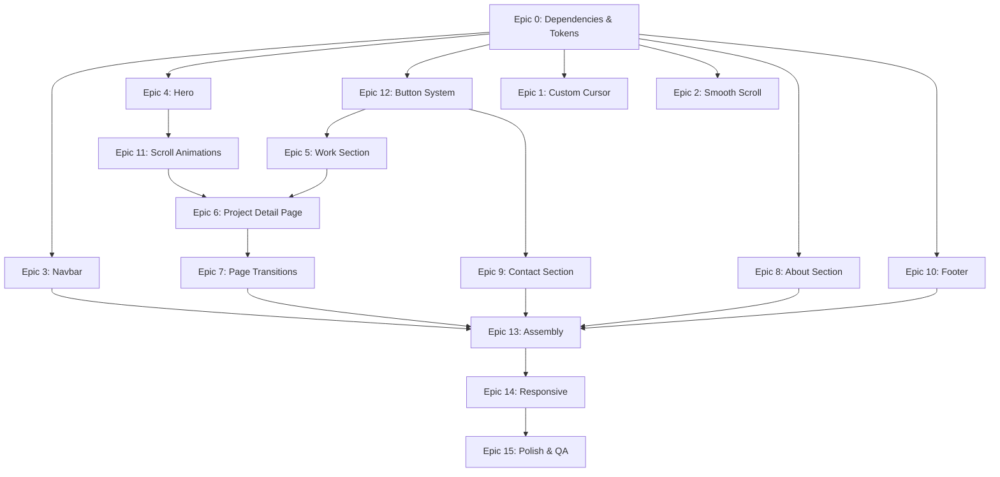

# Phase 2: Design Overhaul — Squared-Media Copycat Implementation Plan

> **Reference**: [squared-media.nl/en](https://www.squared-media.nl/en)
> **Current State**: Phase 1 complete — all functionality working, 29/29 tests passing, Supabase connected
> **Goal**: Transform the current dark-neutral functional portfolio into a premium, cinematic experience matching the Squared Media aesthetic
> **Workspace**: `d:\Frontend\portfolio\app`

---

## Visual Reference Captures

````carousel

<!-- slide -->

<!-- slide -->

<!-- slide -->

<!-- slide -->

<!-- slide -->

<!-- slide -->

````

---

## Design System Reverse-Engineered from Squared Media

### Colors
| Token | Hex | Usage |
|:---|:---|:---|
| `--bg-primary` | `#1A1A1A` | Main dark background |
| `--bg-card` | `#242424` | Card/section backgrounds |
| `--bg-elevated` | `#2E2E2E` | Hover states, elevated surfaces |
| `--text-primary` | `#FFFFFF` | Headlines, strong text |
| `--text-secondary` | `#999999` | Subtitle text, metadata |
| `--text-muted` | `#666666` | Timestamps, fine print |
| `--accent` | `#FF4D1A` | Primary accent (orange-red — "Book a call" button, arrows, highlights) |
| `--border-subtle` | `rgba(255,255,255,0.08)` | Dividers, card borders |
| `--border-tag` | `rgba(255,255,255,0.25)` | Tag pill borders |

### Typography
| Element | Font | Weight | Size | Transform | Tracking | Line-Height |
|:---|:---|:---|:---|:---|:---|:---|
| H1 (Hero) | Compressed Gothic Sans (e.g. **Oswald**, **Bebas Neue**, or PP Neue Montreal Condensed) | 800–900 | `clamp(48px, 8vw, 120px)` | `uppercase` | `-0.02em` | `0.85` |
| H2 (Section) | Same compressed | 700 | `clamp(32px, 5vw, 72px)` | `uppercase` | `-0.02em` | `0.9` |
| Body | Clean geometric sans (e.g. **Plus Jakarta Sans**, **Inter**) | 400 | `18px` | `none` | `0` | `1.6` |
| Tags/Metadata | Monospace-ish / wide sans | 500 | `11px–12px` | `uppercase` | `0.12em` | `1` |
| Nav links | Geometric sans | 500 | `14px` | `none` | `0.02em` | `1` |

### Spacing & Layout
- **Max content width**: `1400px`
- **Section vertical padding**: `120px–160px`
- **Card corner radius**: `16px–24px`
- **Grid gap**: `24px–32px`

### Key UI Patterns from Reference
1. **Navbar**: Floating pill-shaped bar with border-radius, glassmorphism blur, dark bg, accent CTA button ("Book a call" → our "Get In Touch")
2. **Showcase cards**: Massive (roughly 65% viewport width for main card), image fills card area, tags as bordered pills at bottom-right, title + metadata below card — NOT overlaid
3. **Hover**: Image zooms OUT (scale 1 → 0.9), reveals more of the image; a "VIEW ↗" pill badge fades in
4. **Project detail**: Two-column header — massive uppercase title left, description + tags + action button right
5. **Stats/highlights grid**: 3-column with large bold stat, tiny uppercase description below, bordered top/bottom
6. **Media showcase**: Asymmetric 2-column grids, all images with uniform `border-radius: 24px`
7. **Next Case**: Full-width dark section, "NEXT CASE" label, massive title with orange arrow `→`, background image preview, "← ALL CASES" link

---

## Implementation Tasks

### EPIC 0: Infrastructure & Dependencies (Pre-requisite)

#### Task 0.1 — Install Animation & Font Dependencies
**File**: `d:\Frontend\portfolio\app\package.json`
**Action**: Install required packages
```bash
cd d:\Frontend\portfolio\app
npm install framer-motion@latest lenis@latest
```
- **framer-motion**: Page transitions (AnimatePresence), layout animations (layoutId for FLIP), scroll-triggered reveals, spring physics
- **lenis**: Smooth scrolling library (same as reference — confirmed from DOM inspection: "Lenis smooth scrolling and GSAP for the animations")

#### Task 0.2 — Add Google Fonts
**File**: `d:\Frontend\portfolio\app\src\app\layout.tsx`
**Action**: Replace Geist fonts with the Squared Media aesthetic fonts:
- **Headlines**: Import `Bebas_Neue` from `next/font/google` (compressed, uppercase gothic — closest to reference's condensed sans)
- **Body**: Import `Plus_Jakarta_Sans` from `next/font/google` (clean geometric sans)
- Set CSS variables: `--font-display` for headlines, `--font-body` for body text
- Apply to `<html>` className

#### Task 0.3 — Design Token System in globals.css
**File**: `d:\Frontend\portfolio\app\src\app\globals.css`
**Action**: Replace the entire CSS file with a comprehensive design token system:
```css
@import "tailwindcss";

:root {
  /* Colors */
  --bg-primary: #1A1A1A;
  --bg-card: #242424;
  --bg-elevated: #2E2E2E;
  --text-primary: #FFFFFF;
  --text-secondary: #999999;
  --text-muted: #666666;
  --accent: #FF4D1A;
  --accent-hover: #FF6B3D;
  --border-subtle: rgba(255, 255, 255, 0.08);
  --border-tag: rgba(255, 255, 255, 0.25);
  
  /* Typography */
  --font-display: var(--font-bebas-neue), 'Bebas Neue', sans-serif;
  --font-body: var(--font-plus-jakarta), 'Plus Jakarta Sans', sans-serif;
  
  /* Spacing */
  --section-padding: clamp(80px, 10vw, 160px);
  --container-max: 1400px;
  --card-radius: 20px;
  
  /* Transitions */
  --ease-out-expo: cubic-bezier(0.16, 1, 0.3, 1);
  --duration-normal: 0.6s;
  --duration-slow: 1s;
}

body {
  background: var(--bg-primary);
  color: var(--text-primary);
  font-family: var(--font-body);
}

/* Scrollbar */
::-webkit-scrollbar { width: 6px; }
::-webkit-scrollbar-track { background: var(--bg-primary); }
::-webkit-scrollbar-thumb { background: var(--bg-elevated); border-radius: 3px; }

/* Selection */
::selection {
  background: rgba(255, 77, 26, 0.3);
  color: white;
}
```

---

### EPIC 1: Custom Cursor System

#### Task 1.1 — Create CustomCursor Component
**File**: `d:\Frontend\portfolio\app\src\components\CustomCursor.tsx`
**Action**: Create a new `'use client'` component implementing the Squared Media cursor:
- **Default state**: Small dark dot (8px), positioned at mouse coordinates
- **Interactive state**: When hovering over elements with `data-cursor="view"`, expands to ~80px circle with "VIEW ↗" text inside
- **Physics**: Use `framer-motion`'s `useMotionValue` + `useSpring` for smooth, slightly-lagging follow (spring: `stiffness: 400, damping: 28`)
- **Implementation**:
  - Track `mouseX`, `mouseY` via `window.addEventListener('mousemove')`
  - Use `motion.div` with animated `width`, `height`, `x`, `y`
  - Detect hover targets via `mouseenter`/`mouseleave` events on `[data-cursor]` elements
  - Hide on mobile (check `window.matchMedia('(pointer: fine)')`)
  - Add `cursor: none` to `body` when component mounts

#### Task 1.2 — Integrate Cursor into Root Layout
**File**: `d:\Frontend\portfolio\app\src\app\layout.tsx`
**Action**: Import and render `<CustomCursor />` inside `<body>` (only on client side)

#### Task 1.3 — Add `data-cursor` Attributes to Interactive Elements
**Files**: Multiple component files
**Action**: Add `data-cursor="view"` to:
- Project card links (in showcase section)
- Project detail media images
- CTA buttons (optional: `data-cursor="action"` variant)

---

### EPIC 2: Smooth Scroll System

#### Task 2.1 — Create LenisProvider Component
**File**: `d:\Frontend\portfolio\app\src\components\SmoothScroll.tsx`
**Action**: Create a `'use client'` wrapper component:
- Initialize `Lenis` instance with `{ lerp: 0.1, smoothWheel: true }`
- Use `requestAnimationFrame` loop to call `lenis.raf(time)`
- Integrate with Framer Motion's scroll tracking if needed
- Wrap children: `<SmoothScroll>{children}</SmoothScroll>`
- Clean up on unmount

#### Task 2.2 — Wrap App in SmoothScroll
**File**: `d:\Frontend\portfolio\app\src\app\page.tsx`
**Action**: Wrap the main content in `<SmoothScroll>` component

---

### EPIC 3: Floating Glassmorphism Navbar

#### Task 3.1 — Redesign Navbar Component
**File**: `d:\Frontend\portfolio\app\src\components\Navbar.tsx`
**Action**: Complete visual overhaul to match Squared Media:

**Current**: Sticky, full-width, dark bar with bottom border
**Target**: Floating, pill-shaped, centered, glassmorphism

- **Container**: Not full-width. Centered with `max-width: ~1200px`, `margin: 16px auto`, `border-radius: 999px`
- **Background**: `rgba(26, 26, 26, 0.85)` with `backdrop-blur: 16px`
- **Border**: `1px solid rgba(255, 255, 255, 0.08)`
- **Position**: `position: fixed; top: 16px; left: 50%; transform: translateX(-50%); z-index: 50`
- **Left side**: Logo/brand (e.g., `// PORTFOLIO` or initials in Squared's style — two slashes + bold name)
- **Center**: Nav links — "Work", "About", "Contact" — in clean sans-serif, `14px`, uppercase tracking
- **Right side**: Accent pill button ("Get In Touch") — `background: var(--accent)`, `border-radius: 999px`, `padding: 10px 24px`, bold white text
- **Scroll behavior**: Add slight shadow and increased opacity on scroll (use `useMotionValueEvent` from framer-motion to track scroll)
- **Mobile**: Hamburger → slide-down panel with same glassmorphism
- **Animation**: Fade-in + slide-down on page load (`motion.header` with initial `y: -40, opacity: 0`)

---

### EPIC 4: Hero Section Overhaul

#### Task 4.1 — Redesign Hero Component
**File**: `d:\Frontend\portfolio\app\src\components\Hero.tsx`
**Action**: Transform from centered layout to Squared Media's bold statement hero:

**Current**: Centered text with availability badge, gradient glow, social icons
**Target**: Full-width, left-aligned massive uppercase headline with staggered mask-up reveal

- **Layout**: Full viewport height (`min-h-screen`), content positioned with generous padding
- **Remove**: Availability badge (too startup-y for brutalist aesthetic), background gradient glow
- **Main headline**: Massive compressed sans-serif, uppercase, tight leading
  ```
  I BUILD
  DIGITAL
  EXPERIENCES
  ```
  or similar powerful statement using `profile.title`
- **Font**: `font-family: var(--font-display)`, `font-size: clamp(48px, 12vw, 140px)`, `line-height: 0.85`, `letter-spacing: -0.02em`, `text-transform: uppercase`
- **Subtitle**: Below the headline, a `max-width: 500px` paragraph in body font, `18px`, `color: var(--text-secondary)`, describing expertise
- **CTA**: Single vibrant orange pill button — "Explore My Work ↓" or "View Work"
  - `background: var(--accent)`, `border-radius: 999px`, `padding: 14px 32px`
  - Hover: spring-physics scale (`scale: 1.05`), orange glow shadow (`box-shadow: 0 8px 32px rgba(255, 77, 26, 0.4)`)
- **Bottom**: Horizontal scrolling text marquee (like reference's "CREATORS ◆ CAMPAIGN CONTENT ◆ WEBSITES ◆ ..." ticker) — use CSS animation or framer-motion

#### Task 4.2 — Staggered Text Reveal Animation
**Action**: Within the Hero, implement the "mask-up" text reveal:
- Wrap each line of the headline in a `<div style="overflow: hidden">` mask container
- Inside each mask, the text line is a `motion.div` that animates from `y: "100%"` to `y: 0`
- Stagger: Each line delays by `0.15s` after the previous
- Use `framer-motion` `variants` with `staggerChildren: 0.15`
- Easing: `var(--ease-out-expo)` or `[0.16, 1, 0.3, 1]`
- Duration: `0.8s–1s` per line

#### Task 4.3 — Skills Marquee Ticker
**File**: `d:\Frontend\portfolio\app\src\components\MarqueeTicker.tsx`
**Action**: Create a new component for the horizontally scrolling skills bar:
- Infinitely looping horizontal scroll of text items separated by `◆` diamond
- Items: "REACT" ◆ "NEXT.JS" ◆ "TYPESCRIPT" ◆ "TAILWIND" ◆ "SUPABASE" ◆ "NODE.JS" (or from profile)
- All uppercase, tracked, `12px`, `color: var(--text-muted)`
- CSS `@keyframes marquee { from { transform: translateX(0); } to { transform: translateX(-50%); } }`
- Duplicate the list to create seamless loop
- Place at bottom of hero or between hero and work section

---

### EPIC 5: Work / Showcase Section Overhaul

#### Task 5.1 — Redesign MyWorkSection Layout
**File**: `d:\Frontend\portfolio\app\src\components\MyWorkSection.tsx`
**Action**: Transform from 3-column grid with filter tabs to Squared Media's showcase layout:

**Current**: "My Work" heading + 3 filter tabs + 3-column grid of ProjectCards
**Target**: Massive, structural showcase with alternating large/small cards

- **Section header**: Remove filter tabs (brutalist = no clutter). Replace with massive "SELECTED WORK" or "MY WORK" in display font, uppercase
- **Layout**: NOT a uniform grid. Use a more editorial layout:
  - **Primary card**: ~65% width, large image area (aspect-ratio 16/10)
  - **Secondary card**: ~35% width, next to it (or staggered below)
  - Alternating: row 1 = [large, small], row 2 = [small, large]
  - CSS Grid: `grid-template-columns: 1.8fr 1fr` alternating with `1fr 1.8fr`
- **Gap**: `32px`
- **Mobile**: Stack to single column
- **Remove the loading skeleton pulsing divs**: Replace with opacity fade-in

#### Task 5.2 — Redesign ProjectCard (Showcase Card)
**File**: `d:\Frontend\portfolio\app\src\components\ProjectCard.tsx`
**Action**: Complete overhaul to match Squared Media case cards:

**Current**: Dark card with MediaViewer, title, tagline, tags, contributions, action buttons
**Target**: Clean image-dominant card with tags + title below

- **Card structure**:
  ```
  ┌─────────────────────────────────────┐
  │                                     │
  │         PROJECT IMAGE               │
  │         (fills card,                │
  │          border-radius: 20px)       │
  │                                     │
  │              ┌──────┐ ┌─────────┐   │
  │              │ TAG1 │ │ TAG2    │   │  ← pills at bottom-right of image
  │              └──────┘ └─────────┘   │
  └─────────────────────────────────────┘
  THE SANDWICH BAR                        ← bold uppercase title BELOW card
  THE SANDWICH BAR · 2025                 ← metadata line, small, tracked
  ```
- **Image area**: `aspect-ratio: 16/10`, `overflow: hidden`, `border-radius: var(--card-radius)`
- **Image behavior**:
  - Default: Image fills area at `scale(1.05)` with `object-fit: cover`
  - Hover: Image scales to `scale(0.95)` revealing more padding/background around it — this is the Squared Media signature effect
  - Transition: `transform 0.6s var(--ease-out-expo)`
- **Tag pills**: Positioned absolute at bottom-right of image area
  - `border: 1px solid var(--border-tag)`, `border-radius: 999px`, `padding: 6px 16px`
  - `font-size: 11px`, `text-transform: uppercase`, `letter-spacing: 0.12em`
  - `color: white`, `background: transparent` (or very slight rgba white bg)
- **Title**: Below the card image, in display font, uppercase, bold, `24px–32px`
- **Metadata line**: `"PROJECT NAME · YEAR"`, small, `12px`, uppercase, tracked, `color: var(--text-muted)`
- **Remove**: Tagline paragraph, description text, contribution bullets, "Live Demo" / "Source Code" buttons — all of this moves to the project detail page
- **Wrap entire card in a `<Link>`** to `/projects/[slug]` (or use onClick for FLIP transition)
- **Add `data-cursor="view"` to enable custom cursor expansion on hover**

#### Task 5.3 — Scroll-Triggered Card Reveal Animations
**Action**: Cards should animate in as user scrolls:
- Use `framer-motion`'s `motion.div` with `whileInView`
- Initial: `opacity: 0, y: 60`
- Animate: `opacity: 1, y: 0`
- Transition: `duration: 0.8, ease: [0.16, 1, 0.3, 1]`
- `viewport: { once: true, margin: "-100px" }` (trigger before fully visible)
- Stagger between cards using `transition.delay`

---

### EPIC 6: Project Detail Page (NEW — Dynamic Route)

#### Task 6.1 — Create Dynamic Route Structure
**File**: `d:\Frontend\portfolio\app\src\app\projects\[id]\page.tsx`
**Action**: Create a new dynamic route page for individual project detail views:
- Server component that fetches project by ID from Supabase
- Falls back to static data if Supabase unavailable
- Passes project data + next project data to a client component

#### Task 6.2 — ProjectDetailView Client Component
**File**: `d:\Frontend\portfolio\app\src\components\ProjectDetailView.tsx`
**Action**: Build the project detail page matching Squared Media:

**Section 1 — Header (Two-Column)**:
```
┌──────────────────────────────┬────────────────────────────────┐
│                              │                                │
│  THE SANDWICH BAR            │  A site that tastes like the   │
│  (massive, display font,     │  shop: bilingual, with         │
│   uppercase, tight leading)  │  catering as its own way in.   │
│                              │                                │
│                              │  ┌─────────┐ ┌──────────┐     │
│                              │  │WEB DESIGN│ │ANIMATION │     │
│                              │  └─────────┘ └──────────┘     │
│                              │                                │
│                              │  THE SANDWICH BAR · 2025       │
│                              │                                │
│                              │  ┌──────────────────────┐     │
│                              │  │ VISIT LIVE SITE ↗    │     │  ← orange pill or bordered pill
│                              │  └──────────────────────┘     │
└──────────────────────────────┴────────────────────────────────┘
```
- Left column (~55%): Project title in massive display font, uppercase
- Right column (~45%): Description text, tag pills, metadata, action button
- Title font size: `clamp(40px, 7vw, 96px)`
- Action button: Bordered pill with arrow. If primary action → orange fill

**Section 2 — Hero Image**:
- Full-width (with side padding) or edge-to-edge image
- `border-radius: 24px`, massive (aspect-ratio ~16/9 or 21/9)
- This image uses `layoutId` matching the card image for FLIP transition

**Section 3 — Stats/Highlights Grid** (if project has contributions):
- 3-column grid between top and bottom thin border lines
- Each cell: Large bold stat text + small uppercase description
- e.g., `"100%"` / `"CONTENT SELF-MANAGED"` | `"React"` / `"FRONTEND FRAMEWORK"` | `"3 months"` / `"DEVELOPMENT TIME"`

**Section 4 — Body Content**:
- Left-aligned, `max-width: 600px` (65ch), leaving massive whitespace on right
- Section subheadings in display font, `32px`, uppercase
- Body text in geometric sans, `18px`, `line-height: 1.7`, `color: var(--text-secondary)`
- This is where `project.description` and `project.contributions` render

**Section 5 — Media Showcase**:
- Screenshots arranged in alternating layouts:
  - Row 1: Full-width single image
  - Row 2: 2-column asymmetric (60/40 or 50/50)
  - Row 3: Full-width single image
- All images: `border-radius: 24px`, `overflow: hidden`
- YouTube video embeds styled the same way (if `mediaType === 'youtube'`)

**Section 6 — Next Project Navigation**:
```
┌────────────────────────────────────────────────────────────────┐
│                                                                │
│  NEXT CASE                         ← ALL PROJECTS              │
│                                                                │
│  TRIPLE SOLAR →                                                │
│  (massive title + orange arrow)                                │
│                                                                │
│  ┌──────────┐                                                  │
│  │CORP FILMS│                                                  │
│  └──────────┘                                                  │
│  TRIPLE SOLAR · 2025                                           │
│                                                                │
│  [Background: next project's image, dimmed]                    │
└────────────────────────────────────────────────────────────────┘
```
- "NEXT CASE" small label, uppercase, tracked
- Next project title: Massive display font, with orange `→` arrow
- Tag pills + metadata
- Background: Next project's image at low opacity
- "← ALL PROJECTS" link at top-right, uppercase, tracked
- Clicking navigates to next project with page transition

#### Task 6.3 — Update TypeScript Types for Detail Page
**File**: `d:\Frontend\portfolio\app\src\types\portfolio.ts`
**Action**: Add optional fields that support the detail page:
```typescript
export interface Project {
  // ... existing fields ...
  slug?: string;           // URL-friendly slug for routing
  year?: string;           // Project year for display
  highlights?: {           // Stats grid items
    value: string;
    label: string;
  }[];
  screenshots?: string[];  // Array of additional screenshot URLs
}
```

---

### EPIC 7: Page Transitions (FLIP Animation)

#### Task 7.1 — Create Page Transition Provider
**File**: `d:\Frontend\portfolio\app\src\components\PageTransition.tsx`
**Action**: Create an `AnimatePresence`-based transition system:
- Wrap page content in `<AnimatePresence mode="wait">`
- Each page component gets entry/exit animations:
  - Enter: `opacity: 0` → `opacity: 1`, with `y: 30` → `y: 0`
  - Exit: `opacity: 1` → `opacity: 0`, duration `0.3s`
- Key the animation by `pathname` (use `usePathname()` from next/navigation)

#### Task 7.2 — FLIP Transition from Card to Detail Page
**Action**: This is the signature Squared Media interaction:
- On the showcase card's image, set `layoutId={`project-image-${project.id}`}`
- On the detail page's hero image, set the SAME `layoutId={`project-image-${project.id}`}`
- Framer Motion automatically calculates the FLIP (First, Last, Invert, Play) animation
- The image smoothly scales and translates from its card position to its full-width detail position
- Surrounding content fades out/in with `AnimatePresence`
- **Critical**: This requires both pages to be rendered within the same `AnimatePresence` context → use a layout-level wrapper or `motion` shared layout

#### Task 7.3 — Template-Level Animation Wrapper
**File**: `d:\Frontend\portfolio\app\src\app\template.tsx`
**Action**: Create a Next.js template that wraps pages with AnimatePresence:
```tsx
'use client';
import { motion, AnimatePresence } from 'framer-motion';
import { usePathname } from 'next/navigation';

export default function Template({ children }: { children: React.ReactNode }) {
  const pathname = usePathname();
  return (
    <AnimatePresence mode="wait">
      <motion.div
        key={pathname}
        initial={{ opacity: 0 }}
        animate={{ opacity: 1 }}
        exit={{ opacity: 0 }}
        transition={{ duration: 0.3, ease: [0.16, 1, 0.3, 1] }}
      >
        {children}
      </motion.div>
    </AnimatePresence>
  );
}
```

---

### EPIC 8: About Section Overhaul

#### Task 8.1 — Redesign AboutSection
**File**: `d:\Frontend\portfolio\app\src\components\AboutSection.tsx`
**Action**: Match the editorial, whitespace-heavy style:

**Current**: "About Me" heading + bio text + embedded ResumeViewer
**Target**: Minimalist, asymmetric two-column layout

- **Left column (40%)**: Section label "ABOUT" in display font, `64px`, uppercase
- **Right column (60%)**: 
  - Bio narrative in body font, `18px`, `line-height: 1.7`, `max-width: 55ch`
  - Below: "Download CV" pill button (bordered, not filled) + "View Resume" link
- **Remove** the embedded iframe CV viewer from the main view (too heavy for brutalist aesthetic — keep as separate link/modal)
- **Scroll reveal**: Entire section fades in with `whileInView`

---

### EPIC 9: Contact Section Overhaul

#### Task 9.1 — Redesign ContactSection
**File**: `d:\Frontend\portfolio\app\src\components\ContactSection.tsx`
**Action**: Transform into a bold CTA section:

**Current**: "How to Reach Me" with icon cards for email, phone, GitHub, LinkedIn
**Target**: Massive typographic CTA, like the reference site's bold sections

- **Layout**: Dark background (or slightly different shade), full-width
- **Main text**: Massive display font headline — "LET'S WORK TOGETHER" or "GOT A PROJECT?" — `clamp(48px, 10vw, 120px)`, uppercase
- **Subtitle**: One line in body font: "I'm available for freelance work and collaborations"
- **CTA Button**: Large orange pill — "Get In Touch →"
  - `background: var(--accent)`, `border-radius: 999px`, `padding: 18px 48px`
  - Spring-physics hover scale + glow shadow
- **Below**: Simple row of social links (GitHub, LinkedIn, Email) as small icons, `color: var(--text-muted)`
- **Remove**: Individual contact cards with detailed info, phone number display, "Copy Email" button (simplify)

---

### EPIC 10: Footer Overhaul

#### Task 10.1 — Redesign Footer
**File**: `d:\Frontend\portfolio\app\src\components\Footer.tsx`
**Action**: Minimal, clean footer:
- Two columns or centered layout
- Left: `© 2025 [Name]` in small text
- Right: Social icons (GitHub, LinkedIn) + "Back to top" link
- Thin top border: `1px solid var(--border-subtle)`
- Padding: `40px 0`
- No excessive content

---

### EPIC 11: Scroll-Triggered Animations (Global)

#### Task 11.1 — Create AnimatedSection Wrapper
**File**: `d:\Frontend\portfolio\app\src\components\AnimatedSection.tsx`
**Action**: Reusable `whileInView` wrapper component:
```tsx
interface Props { 
  children: React.ReactNode; 
  delay?: number; 
  className?: string;
}
```
- Uses `motion.div` with `whileInView={{ opacity: 1, y: 0 }}`
- Initial: `opacity: 0, y: 40`
- Transition: `duration: 0.7, ease: [0.16, 1, 0.3, 1], delay`
- `viewport: { once: true, margin: "-50px" }`

#### Task 11.2 — Create TextReveal Component
**File**: `d:\Frontend\portfolio\app\src\components\TextReveal.tsx`
**Action**: Reusable "mask-up" text reveal for headings:
- Splits text into lines (via `<span>` per line or auto-split)
- Each line wrapped in `overflow: hidden` container
- Inner `motion.span` animates `y: "110%"` → `y: 0`
- Stagger between lines: `0.12s`

#### Task 11.3 — Apply Animations Throughout
**Files**: All section components
**Action**: Wrap section headings in `<TextReveal>`, wrap content blocks in `<AnimatedSection>`:
- Hero headline → `<TextReveal>` with stagger
- Work section title → `<TextReveal>`
- Each project card → `<AnimatedSection delay={index * 0.1}>`
- About section → `<AnimatedSection>`
- Contact CTA → `<TextReveal>` for the headline

---

### EPIC 12: Button System Overhaul

#### Task 12.1 — Create Button Component
**File**: `d:\Frontend\portfolio\app\src\components\Button.tsx`
**Action**: Create a reusable button component with two variants:

**Variant 1 — Primary (Filled Orange)**:
- `background: var(--accent)`, `color: white`
- `border-radius: 999px`, `padding: 14px 32px`
- `font-weight: 600`, `font-size: 14px`, `text-transform: uppercase`, `letter-spacing: 0.06em`
- Hover: `scale: 1.05` (spring), `box-shadow: 0 8px 32px rgba(255,77,26,0.4)`
- Use `motion.button` or `motion.a` for spring animation

**Variant 2 — Ghost (Bordered)**:
- `background: transparent`, `border: 1px solid var(--border-tag)`, `color: white`
- Same radius, padding, text styling
- Hover: `background: rgba(255,255,255,0.05)`, `border-color: rgba(255,255,255,0.4)`

#### Task 12.2 — Create TagPill Component
**File**: `d:\Frontend\portfolio\app\src\components\TagPill.tsx`
**Action**: Reusable tag pill for services/tech stack:
- `border: 1px solid var(--border-tag)`, `border-radius: 999px`
- `padding: 6px 16px`, `font-size: 11px`, `text-transform: uppercase`, `letter-spacing: 0.12em`
- `color: white`, `background: transparent`

---

### EPIC 13: Page Assembly & Route Updates

#### Task 13.1 — Update Root Layout
**File**: `d:\Frontend\portfolio\app\src\app\layout.tsx`
**Action**:
- Replace fonts (Task 0.2)
- Import `CustomCursor` (Task 1.2)
- Update metadata with new title/description
- Remove old font variables, update body classes
- Add template wrapper for page transitions

#### Task 13.2 — Update Homepage (page.tsx)
**File**: `d:\Frontend\portfolio\app\src\app\page.tsx`
**Action**:
- Integrate `SmoothScroll` wrapper
- Update section ordering: Hero → Marquee → Work → About → Contact → Footer
- Remove Navbar from here (move to layout)
- Ensure proper `id` anchors for nav scroll targets

#### Task 13.3 — Update next.config.ts for New Routes
**File**: `d:\Frontend\portfolio\app\next.config.ts`
**Action**: Ensure image domains are configured, verify no issues with dynamic routes

---

### EPIC 14: Responsive Design Pass

#### Task 14.1 — Mobile Navbar
- Hamburger icon → slide-down panel with same dark blur
- Links stack vertically
- CTA button full-width at bottom

#### Task 14.2 — Mobile Hero
- Reduce font size via `clamp()` — already responsive
- Stack button below headline
- Marquee remains horizontal scroll

#### Task 14.3 — Mobile Showcase
- Cards stack to single column
- Full-width images
- Tags wrap below image

#### Task 14.4 — Mobile Project Detail
- Header columns stack (title on top, description below)
- Stats grid: 1 or 2 columns
- Screenshots: full-width, single column

#### Task 14.5 — Mobile Contact
- Reduce headline size
- CTA button full-width

---

### EPIC 15: Polish & Verification

#### Task 15.1 — Run Tests
```bash
cd d:\Frontend\portfolio\app
npm test
```
- Ensure all 29 existing tests still pass
- Fix any breaking changes from component restructuring
- Update test files if component props/structure changed significantly

#### Task 15.2 — TypeScript Check
```bash
npx tsc --noEmit
```
- Fix all type errors introduced by new components

#### Task 15.3 — Build Check
```bash
npm run build
```
- Ensure production build succeeds with zero errors
- Verify no hydration warnings

#### Task 15.4 — Visual QA Checklist
- [ ] Custom cursor works on desktop, hidden on mobile
- [ ] Smooth scroll feels natural, not janky
- [ ] Navbar floats, blurs, transitions on scroll
- [ ] Hero text reveal animation plays on load
- [ ] Marquee scrolls infinitely without glitches
- [ ] Showcase cards have correct hover (image zoom-out + VIEW pill)
- [ ] Clicking a card navigates to detail page with smooth transition
- [ ] Detail page layout matches specification
- [ ] Next Project navigation works at bottom of detail page
- [ ] Contact CTA has bouncy orange button with glow
- [ ] All text is correct font (display vs body)
- [ ] Colors match token system
- [ ] Responsive on mobile (320px, 768px, 1024px, 1440px)
- [ ] No horizontal scroll overflow
- [ ] Admin routes (`/admin`, `/admin/login`) still work unchanged

---

## Execution Order (Dependency Graph)



### Recommended Execution Sequence:
1. **Epic 0** → Tokens, fonts, dependencies (foundation)
2. **Epic 12** → Button & tag components (used everywhere)
3. **Epic 11** → Animation primitives (AnimatedSection, TextReveal)
4. **Epic 1** → Custom cursor
5. **Epic 2** → Smooth scroll
6. **Epic 3** → Navbar redesign
7. **Epic 4** → Hero redesign
8. **Epic 5** → Work showcase redesign
9. **Epic 8** → About section
10. **Epic 9** → Contact section
11. **Epic 10** → Footer
12. **Epic 6** → Project detail page (NEW)
13. **Epic 7** → Page transitions (FLIP)
14. **Epic 13** → Assembly & route updates
15. **Epic 14** → Responsive pass
16. **Epic 15** → Tests, types, build, visual QA

---

## Files Changed Summary

| Action | File |
|:---|:---|
| **MODIFY** | `package.json` — add framer-motion, lenis |
| **MODIFY** | `src/app/layout.tsx` — fonts, cursor, metadata |
| **MODIFY** | `src/app/globals.css` — full design token system |
| **MODIFY** | `src/app/page.tsx` — new section ordering |
| **MODIFY** | `src/components/Navbar.tsx` — floating glassmorphism pill |
| **MODIFY** | `src/components/Hero.tsx` — massive headline + reveal animation |
| **MODIFY** | `src/components/MyWorkSection.tsx` — editorial showcase layout |
| **MODIFY** | `src/components/ProjectCard.tsx` — image-dominant card with hover zoom |
| **MODIFY** | `src/components/AboutSection.tsx` — asymmetric editorial |
| **MODIFY** | `src/components/ContactSection.tsx` — bold CTA |
| **MODIFY** | `src/components/Footer.tsx` — minimal |
| **MODIFY** | `src/types/portfolio.ts` — new fields |
| **CREATE** | `src/components/CustomCursor.tsx` |
| **CREATE** | `src/components/SmoothScroll.tsx` |
| **CREATE** | `src/components/MarqueeTicker.tsx` |
| **CREATE** | `src/components/AnimatedSection.tsx` |
| **CREATE** | `src/components/TextReveal.tsx` |
| **CREATE** | `src/components/Button.tsx` |
| **CREATE** | `src/components/TagPill.tsx` |
| **CREATE** | `src/components/PageTransition.tsx` |
| **CREATE** | `src/components/ProjectDetailView.tsx` |
| **CREATE** | `src/app/template.tsx` — AnimatePresence wrapper |
| **CREATE** | `src/app/projects/[id]/page.tsx` — dynamic detail route |
| **UNCHANGED** | `src/components/MediaViewer.tsx` — still used internally |
| **UNCHANGED** | `src/components/ResumeViewer.tsx` — linked from About, not embedded |
| **UNCHANGED** | `src/components/admin/*` — admin pages untouched |
| **UNCHANGED** | `src/lib/*` — all utilities untouched |
| **UNCHANGED** | `tests/*` — update only if component interfaces break |

> [!IMPORTANT]
> **Admin dashboard (`/admin`) and all backend functionality remain 100% untouched.** This plan only modifies the public-facing design layer.

> [!TIP]
> The plan is self-contained. Each Epic can be executed independently with the tasks providing exact file paths, component structures, CSS values, and animation parameters. No external context needed.
